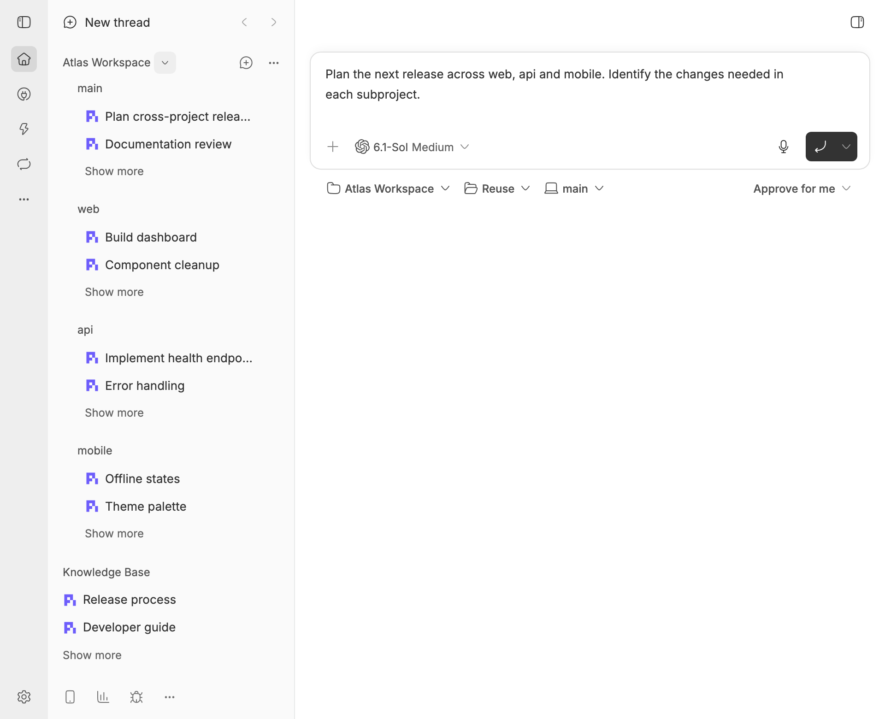
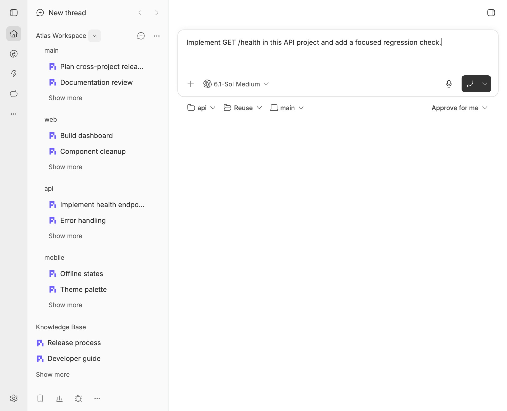
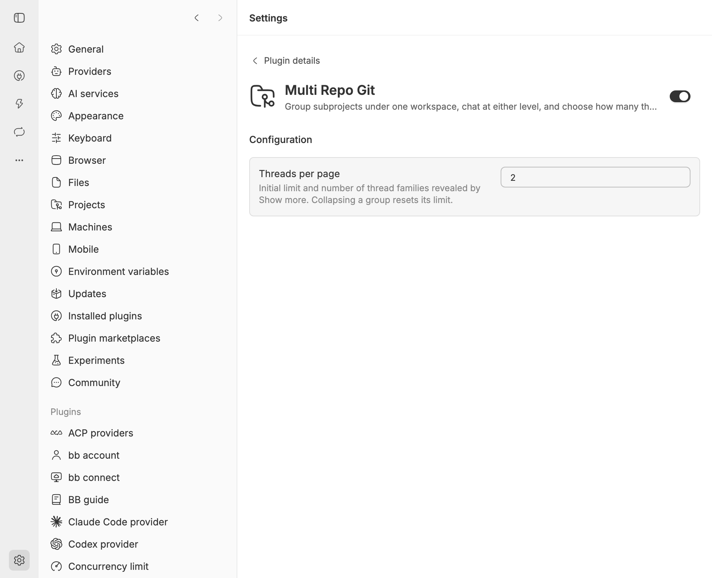
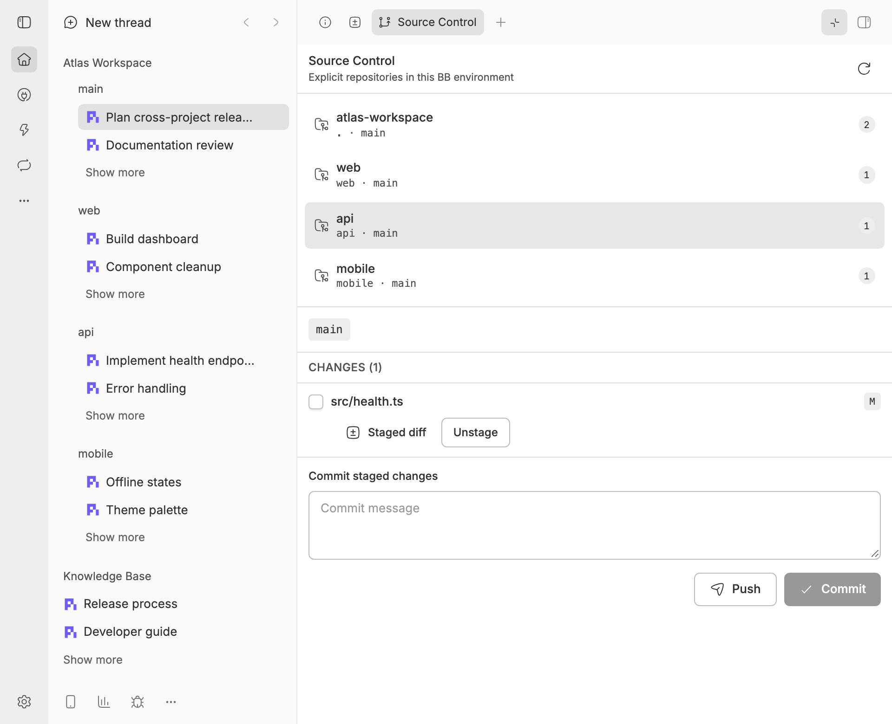

# Multi Repo Git for BB

Group folder-based **subprojects inside one workspace**, then choose where to
chat: about the whole project in **main**, or within a specific subproject.
Set how many thread families each project shows, with independent **Show more**
controls. Repository-local **Source Control** is also included.

## Workspaces and chat scope

- Connect folders such as **web**, **api** and **mobile** beneath a workspace
  through **Edit workspace** in the native project menu.
- Start a workspace chat in **main** for cross-project planning and work from
  the workspace's active environment.
- Start a chat under a child project to work within that subproject's own
  project and active environment.
- Set **Threads per page** from **1 to 100** (default **5**) to control the
  initial number of visible thread families independently for each project.

Use BB's native **New thread** flow and choose the workspace or child project.
The plugin groups existing BB projects; it does not introduce a separate chat
system. Disconnecting a folder leaves its project, chats and files intact.
Workspace membership is one level: a child project cannot itself own a workspace.

## Compatibility

Requires **BB ≥0.46 and SDK ≥0.6.37**, with the built-in `thread-list`
sidebar provider. Installation and actual UI behavior were verified on this
build. BB builds with the same version number can ship different SDKs:
the 0.46.0 build with SDK 0.4.97 lacks the required `thread-list` and is not
supported. Compatibility with replacement sidebar plugins is not guaranteed.
The SDK 0.4.97 development pin provides compile-time types; it does not define
the minimum SDK version of the running BB instance.

## Current features

- **Edit workspace** groups selected child folders as real BB projects,
  reusing matching projects and their available machine sources where possible;
- workspace chats appear in **main**, while child projects keep their own chats;
- configurable thread-family limits, independent **Show more** controls, and
  native thread ordering, groups and actions;
- native Project settings, Rename, Remove, sections, pinned threads and
  drag-and-drop remain available;
- **New tab → Actions → Source Control** for every thread;
- a workspace root shows its own repository plus explicitly linked member paths;
- an ordinary or child project shows only its own active environment;
- unavailable, missing, non-repository, and out-of-workspace members stay visible
  with an explanation and without Git mutation controls;
- repository-local status, diff, stage, unstage, branch creation, commit, and
  push with path confinement and literal Git pathspecs.

The domain model and parity requirements are documented in
[`docs/architecture.md`](docs/architecture.md) and
[`docs/sidebar-parity.md`](docs/sidebar-parity.md).

## Sidebar thread pagination

Each project and child project initially shows five top-level thread families.
**Show more** reveals the next page while preserving native ordering, groups
and actions. Descendants remain with their parent and do not consume extra
slots. Collapsing a project, child project or `main` group resets its limit;
collapsing a workspace also resets its child-project limits.

Set **Threads per page** in the installed **Multi Repo Git** plugin's settings
(an integer from 1 to 100, default 5). Changes immediately reset every project's
initial limit. BB persists project and thread collapse state (`thread-list`:
`collapsedProjects`, `collapsedThreads`); the plugin persists `main` locally.
BB may automatically expand the selected thread's project and ancestor path
after a reload. The pagination limit returns to the initial page size on reload.
Threads are never deleted or archived: pagination hides native rows and stable
virtualization wrappers rather than creating a replacement list.

```bash
bb plugin config multi-repo-git set chatsPerPage 5
```

## Adaptive Source Control concurrency

Before each scan, the plugin samples available CPUs and the repository host's
one-minute load using Node.js `availableParallelism()` and `loadavg()`.
The budget is `max(1, min(4, floor((CPU − load) / 4)))` concurrent repositories;
each repository performs up to four independent Git reads in parallel.
Under heavy load, repository scanning becomes sequential. The budget is fixed
for one scan and resampled on the next refresh. This is a conservative
heuristic, not an exact measurement of free CPU or disk capacity.
On Windows, `loadavg()` returns zero, so only CPU count determines the budget.
The limit applies per scan, not across all concurrent host RPCs. Result order
is preserved. Stage, commit, push and other mutations are not parallelized.
No manual configuration is required.

## Worktrees and lifecycle ownership

The plugin does not create, merge, remove, or otherwise manage worktrees. Start
isolated work from BB's native **New thread** flow and choose the project,
machine, source, and new-worktree placement there. BB owns the resulting
environment, worktree, branch, archive behavior, and cleanup lifecycle.

For a workspace-root environment, member repositories are projected at their
explicit relative paths inside that active environment. The plugin never clones
a missing repository and never falls back to an ordinary project source. A
missing or unsafe member is shown as unavailable until BB provides it in the
active environment.

Provision extra repositories as part of the target project's normal isolated
environment setup: use declared Git submodules, materialize them from
`.bb-env-setup.sh`, and/or copy required untracked local inputs with
`.worktreeinclude`. The plugin does not generate or run a universal setup recipe.
Before the final thread using a native environment is archived or deleted,
preserve durable work explicitly with repository-local commits and a push, pull
request, or other project integration flow; BB may then clean its managed
worktree and branch according to the native lifecycle.

Databases created by older plugin versions may still contain plugin-managed
worktree-set records. They are displayed as a read-only legacy inventory for
manual recovery. The plugin never mutates those records or removes their paths;
BB does not own those historical paths either.

## Safety behavior

- Git operations always target one explicitly selected, available repository.
- Commit and push are blocked in detached HEAD until a branch is created.
- Push uses the configured upstream; with no upstream it publishes the current
  branch to `origin` using `--set-upstream`.
- There are no discard, reset, checkout-overwrite, force-push, pull, implicit
  merge, automatic gitlink commit, worktree lifecycle, or repository clone
  actions.
- Disconnecting a workspace child removes only the logical relation; projects,
  chats, environments, worktrees, branches, and files remain BB/Git-owned.

## Install from GitHub

```bash
bb plugin install 'git:https://github.com/nicolay-i/bb-plugin-multi-repo-git.git@^0.1.0' --yes
```

## Screenshots

### Nested subprojects and a workspace-wide chat



### A chat scoped to one subproject



### Configurable thread limits



### Source Control



[Native project menu](docs/screenshots/workspace-menu.png) ·
[Workspace editor](docs/screenshots/workspace-editor.png)

## Install locally

```bash
npm ci
npm run typecheck
npm test -- --fileParallelism=false --maxWorkers=1 --testTimeout=60000
npm run build
bb plugin install path:/absolute/path/to/bb-plugin-multi-repo-git --yes
```

After edits:

```bash
npm run build
bb plugin reload multi-repo-git
```

## Use

1. Open a project's `…` menu and choose **Edit workspace**.
2. Check or uncheck folders and choose **Update workspace**.
3. Create isolated work, when needed, through BB's native **New thread** screen
   and its project/machine/source/worktree choices.
4. Open a thread's right panel and choose
   **New tab → Actions → Source Control**.
5. Select an available repository, inspect diffs, and run only the intended
   repository-local action.

## Development

```bash
npm run typecheck
npm test
npm run build
bb plugin logs multi-repo-git -f
```

Runtime entries:

- `server.ts` owns workspace relations, active-environment projection, typed
  RPC routing, and read-only legacy inventory;
- `host.ts` performs argument-safe path and Git operations on the target host;
- `app.tsx` renders Source Control and legacy notices;
- `sidebar.tsx` preserves the native sidebar and applies workspace grouping;
- `lib/git.ts`, `lib/paths.ts`, and `lib/workspaces.ts` hold testable Git,
  confinement, and workspace logic;
- `lib/worktree-sets.ts` retains historical migrations and exposes legacy rows
  without mutation.

## License

[MIT](LICENSE): use, modification and commercial distribution are permitted
with the license notice preserved. Adapted components retain their upstream
notices in [THIRD_PARTY_NOTICES.md](THIRD_PARTY_NOTICES.md).
